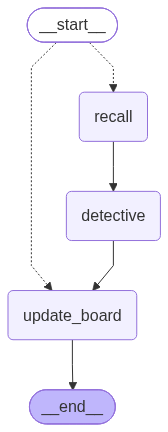

# True AI Detective

A private AI detective that investigates cases over time: it works with mixed evidence, remembers each client's case, researches the web, and produces evidence-backed findings.

It is a learning project, and meant as a **reference for a non-trivial LangChain / LangGraph application**: every library is used directly, as its documentation shows (no wrappers), every feature arrived as one end-to-end story, and every story lists what it teaches.

## What it does today

- **A chat with a detective** (Next.js + CopilotKit, over AG-UI) that keeps one case per client, across visits.
- **An evidence locker**: photos (EXIF + a vision model), PDFs, text, web pages and map pins become facts, each citing its source verbatim.
- **Case memory (RAG)**: facts and text in pgvector, recalled with hybrid search (vectors + Postgres full text).
- **An investigation loop**: a decision model (JEV) picks the next step each turn (research, ask, consult or conclude), and the research step calls tools (case file, web search via self-hosted SearXNG, web pages, the Wayback Machine, RDAP, DNS, image search, and looking at a picture with a question), filing what it finds as evidence with its provenance, the pictures that show what it looks for included.
- **A live case board**: leads, hypotheses, timeline, contradictions, streamed as shared state.
- **Isolation in the database**: Postgres row-level security for every client's data, including the libraries' own tables (checkpoints, vectors).
- **Every run traced** in LangSmith.



## Learn from it

- [`PLAN.md`](PLAN.md) is the board: each story's *Done when* column says how it is proven, its *You'll learn* column what it teaches, and the decisions table why things are the way they are. [Future directions](PLAN.md#future-directions) are there too.
- Start in [`src/detective/agent.py`](src/detective/agent.py) (the graph), then [`research.py`](src/detective/research.py) (tools), [`memory.py`](src/detective/memory.py) (RAG), [`evidence_analysis.py`](src/detective/evidence_analysis.py) (map-reduce with `Send`, structured output, citation checking).
- The e2e tests in [`tests/e2e/`](tests/e2e/) run real processes against fake model servers and recorded HTTP; they show how to test LLM apps without paying for, or depending on, a model.

Stack: Python 3.14, uv, FastAPI, Pydantic, SQLAlchemy + Alembic, Postgres 18 + pgvector, LangChain, LangGraph, LangSmith, OpenAI (`gpt-5.4-nano`), JEV via Vercel AI Gateway, SearXNG, Next.js 16, CopilotKit v2, Railway.

## Run it locally

Needs Docker, [uv](https://docs.astral.sh/uv/), [just](https://just.systems) and Node.

```sh
cp .env.example .env   # add your OpenAI and AI Gateway keys; every variable is explained there
just setup             # Python and web dependencies, Playwright's Chromium
just dev               # Postgres, S3 (RustFS) and the api on :8000; `docker compose up -d searxng` for web search
just web               # the web app on :3000 (another terminal)
just invite you@example.com "Your Name" owner   # prints a one-time invite link
```

`just test` runs the e2e suite (no keys needed, nothing paid), `just check` the linters and type checkers.

## How it is built

Built with [Claude Code](https://claude.com/claude-code), one story per session, under [Shift Zero](https://github.com/jacus/shift-zero): CI inside the session. Before Claude may call a change done, it proves it end to end through the real interface, shows each new test fails on the old code, and writes the evidence; a gate replays that evidence and blocks the reply if it is stale or failing. There is no other CI: this repo's commands and how each is proven are in [`.shift-zero/PORT.md`](.shift-zero/PORT.md), and how Claude works here is in [`CLAUDE.md`](CLAUDE.md).

---

## The original brief

The point is to learn production-minded AI engineering: Python, model APIs, LangGraph, retrieval, MCP, security boundaries, and observability. Keep the design as simple as possible; use frameworks when they solve a real problem.

### Example use cases

- **Find a lead:** A client shares a name, a few links, and a story. The detective asks follow-up questions, researches permitted sources, and records evidence and uncertainties.
- **Connect evidence:** A client provides documents, screenshots, photos, map locations, and URLs. The detective extracts useful details, builds a timeline, and identifies contradictions or gaps.
- **Resume an investigation:** The client returns days later with a new clue. The detective retrieves the right case memory, revisits hypotheses, and continues from where it left off.
- **Consult and conclude:** The detective shares interim findings, asks the client to verify assumptions, then creates a sourced report when there is enough evidence or the investigation reaches its limit.

The system should accept varied inputs; it is not an image-first product.

### How the investigation loop might work

```text
Client message / new evidence
          |
          v
  Load authorized case state
          |
          v
  Analyze evidence and update case
          |
          v
  Decide next step
    |       |        |          |
 research  ask      consult    conclude
    |       |        |          |
    +-------+--------+       final report
            |
      new info arrives
            |
       loop to analysis
```

LangGraph is a candidate to orchestrate this loop and support branching, checkpoints, client-approval pauses, and resuming later. The same flow can start as ordinary Python functions; use LangGraph when its workflow/state features are useful. LangChain is optional tooling for model and retrieval integrations, not a requirement.

### Memory and privacy

- Each client/case has separate persistent memory: conversation history, evidence, leads, hypotheses, and findings.
- Do **not** anonymize case data as a substitute for privacy. The system may need real details to investigate.
- Do prevent data from leaking across clients/cases. Enforce authorization in application/database/tool layers—not through prompts alone. Scope vector search, files, caches, background jobs, and memory retrieval to the authorized case.
- The oversight agent can flag suspicious behavior and alert the agency owner, but deterministic controls must block unauthorized actions even if the oversight agent misses them.
- Treat evidence and web content as untrusted input. Keep sensitive customer content out of logs/traces by default; configure model providers according to the intended privacy requirements.

### Initial technical direction

- **Python + FastAPI + Pydantic:** API and typed domain models.
- **PostgreSQL:** clients, cases, evidence metadata, conversations, permissions, and audit events.
- **Object storage:** uploaded files and derived artifacts.
- **Full-text search + pgvector:** search evidence, always filtered by access permissions.
- **Multimodal LLM API:** analyze different input formats; start with one capable model.
- **LangGraph:** stateful investigation workflow if needed.
- **MCP:** expose a small set of controlled investigation tools when there is a real integration use case.
- **Langfuse or LangSmith + OpenTelemetry:** model/workflow traces and end-to-end observability, with sensitive-data redaction.

### Build in small steps

1. Create cases and store evidence with strict case-level access checks.
2. Add evidence analysis and source-linked structured findings.
3. Implement the investigation loop and persistent memory, including client follow-ups.
4. Add the oversight checks, alerts, tool restrictions, and observability.
5. Test cross-client isolation, prompt injection in evidence, failed/resumed workflows, and source-backed reporting.

**Working rule:** prioritize a useful detective and demonstrable isolation. Don't add agents or frameworks just to tick boxes.